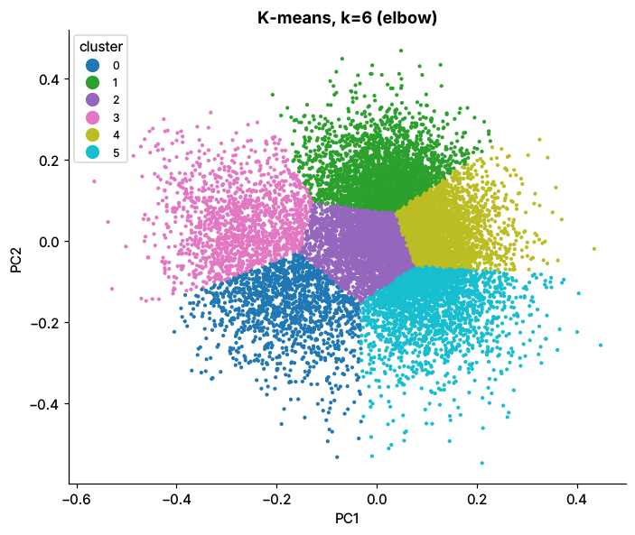
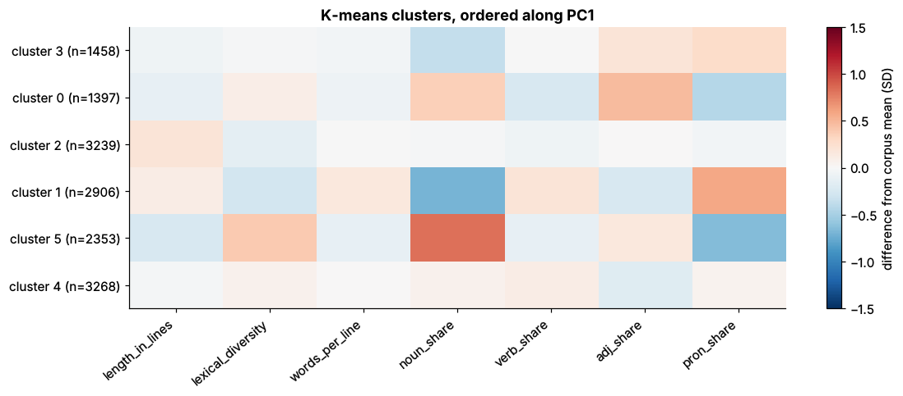
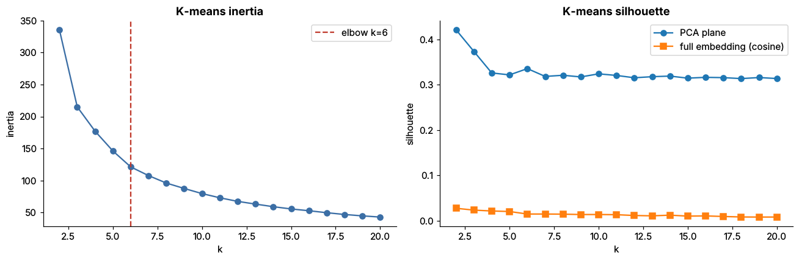
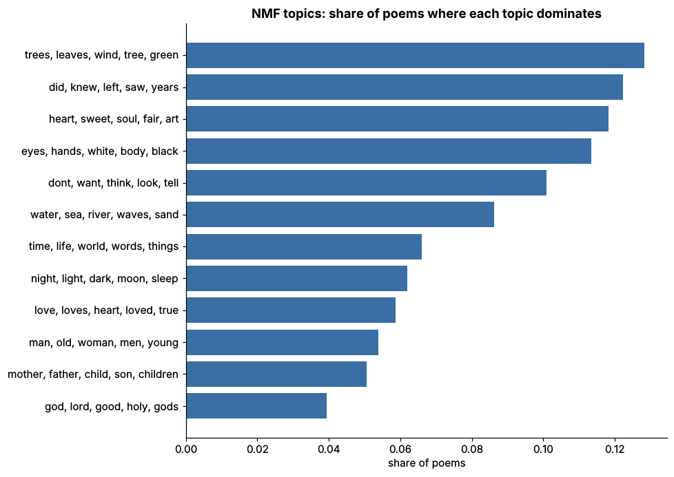
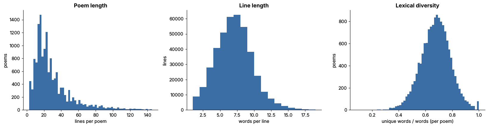

# Poetry NLP: mapping 14,600 poems by how they use language

What structure shows up when you turn a large poetry corpus into data? This project
cleans the full Poetry Foundation collection (15,652 poems by 3,310 poets), profiles
it at the poem and line level, embeds every poem with Doc2Vec, and compares four
clustering methods on the embeddings. It then describes the clusters by their
vocabulary and grammar and fits a topic model for a second view.

The short answer: the strongest signal in the embeddings is **diction and register,
not subject matter**. The first principal component runs from Elizabethan and
Romantic diction to plain contemporary speech, and the one split that model
selection supports is traditional versus modern language.

## Findings

### 1. The main axis is a diction gradient

K-means on the two-component projection (elbow at k = 6) gives six groups that line up
along PC1. Ordered by their mean position on that axis, their most over-represented
terms read as a walk from old diction to new:

| Cluster (along PC1) | Poems | Over-represented terms | What stands out |
| --- | ---: | --- | --- |
| Early modern diction | 1,458 | love, fair, vain, wit, unto, hast, art, dost, alas | most pronouns of the traditional groups |
| 18th–19th c. lyric | 1,397 | sweet, oer, heart, thro, winds, heaven, morn, sea | highest adjective share (8.8%) |
| General lyric | 3,239 | light, world, time, eyes, life, night, old, body | longest poems (34.0 lines on average) |
| Conversational | 2,906 | dont, want, think, people, really, didnt, tell | most pronouns (14.1%), fewest nouns (20.0%), longest lines (8.8 words), lowest lexical diversity (0.646) |
| Nature imagery | 2,353 | water, sky, light, blue, wind, leaves, moon, green | most nouns (28.3%), fewest pronouns (8.0%), highest lexical diversity (0.720), shortest poems (24.2 lines) |
| Body and interior | 3,268 | inside, black, room, hands, white, mother, body, door | concrete domestic and bodily imagery |

The period labels are a reading of the term lists ("oer" and "thro" are the
cleaned forms of *o'er* and *thro'*); the dataset carries no dates.





### 2. Model selection finds one real boundary

| Method (on the PC1/PC2 plane) | Setting | Clusters | Silhouette |
| --- | --- | ---: | ---: |
| K-means | best silhouette, k = 2 | 2 | 0.421 |
| K-means | elbow, k = 6 | 6 | 0.336 |
| Gaussian mixture | lowest BIC: full covariance | 2 | 0.442 |
| DBSCAN | best grid point, eps = 0.025, min_samples = 5 | 3 | 0.398 |
| Agglomerative | complete linkage, cosine, k = 7 | 7 | 0.218 |

The Gaussian mixture's BIC picks two components, and its smaller component (3,049 poems)
is 92% made of the two traditional-diction clusters above. DBSCAN's best grid point is
one cluster of 14,467 poems plus two groups of 6 and 7, so density-based clustering
sees a single continuous body of work. In the full 500-dimensional embedding, K-means
silhouettes stay below 0.03 for every k from 2 to 20, and PC1 and PC2 together carry
only 3.7% of the variance (444 components are needed for 99%). The groups in the table
are useful slices of a continuum, and the diction axis is the part of it that is sharp.



### 3. Topics: nature, memory, the body and the heart

A 12-topic NMF model over TF-IDF (8,728-term vocabulary, archaic function words removed)
gives the subject-matter view. Share of poems where each topic dominates:



Topics and clusters agree where you would expect: 57% of the early-modern cluster is
dominated by the *heart, sweet, soul, fair, art, heaven* topic, and the conversational
cluster splits between *dont, want, think, look, tell* (30%) and the narrative-memory
topic *did, knew, left, saw, years* (24%).

### 4. The corpus at a glance

- **15,652 → 14,621 poems.** Deduplication by text and by author/title leaves 15,606;
  removing length outliers (|z| ≥ 1.5), poems under three lines and scraping artefacts
  (any "word" of 20+ characters) leaves 14,621.
- **434,054 → 411,934 lines** after line-length and word-length outlier filters.
- A typical poem has **23 lines** (mean 29.7); a typical line has **7 words** (mean 6.6).
  Unique-word share per poem averages **0.676**.
- spaCy tags 3.04 million tokens: **nouns 23.6%**, verbs 13.8%, adpositions 12.0%,
  pronouns 11.2%, determiners 11.1%, adjectives 7.2%.
- The Doc2Vec model (DBOW, 500 dimensions, 50 epochs, 47,416-word vocabulary) is
  self-consistent: for 500 sampled poems, re-inferring a vector from the poem's words
  returns that poem as the nearest neighbour every time.



### 5. Sequence models (notebooks/experiments)

The original project also aimed at generation. A word-level LSTM over all lines needs
one-hot targets of 2,259,717 sequences × 121,325 words, which is 1,021 GiB as float32;
the notebook records that allocation failing. The line-level alternative predicts the
next line's Doc2Vec vector from the previous six with a bidirectional LSTM; after one
epoch its validation log-cosh loss (5.20e-4) matched its training loss. Sparse targets
with an embedding layer, or a subword language model, are the natural next step.

## Running it

### 1. Get the data

The corpus is the [Complete Poetry Foundation Dataset](https://www.kaggle.com/datasets/johnhallman/complete-poetryfoundationorg-dataset)
by John Hallman on Kaggle: one CSV, `kaggle_poem_dataset.csv`, with columns
`Author, Title, Poetry Foundation ID, Content` (15,652 rows). The poems are scraped
from poetryfoundation.org and remain the work of their authors, so this repository
contains code and aggregate results only.

With a Kaggle API token in `~/.kaggle/kaggle.json`:

```shell
python scripts/download_data.py      # -> data/raw/kaggle_poem_dataset.csv
```

Or download the zip from the dataset page and unzip it into `data/raw/`.

### 2. Install

Python 3.10+ (tested on 3.13):

```shell
python -m venv .venv && source .venv/bin/activate
pip install -r requirements.txt      # includes spaCy's en_core_web_sm model
```

### 3. Run

```shell
python -m poetry_nlp.pipeline
```

This runs five steps in order; each can also be run alone with `python -m poetry_nlp.<step>`:

| Step | Does | Writes |
| --- | --- | --- |
| `prepare` | cleans, deduplicates and filters poems and lines | `data/interim/poems.pkl`, `lines.pkl`, `results/corpus_stats.json` |
| `syntax` | spaCy part-of-speech profile per poem | `data/interim/poem_pos.pkl`, `results/pos_stats.json` |
| `embed` | trains Doc2Vec DBOW and embeds every poem (`--vector-size`, `--epochs`) | `models/`, `data/interim/poem_vectors.npy`, `results/embedding.json` |
| `cluster` | PCA projection; K-means, DBSCAN, agglomerative and GMM with scores | `results/clustering.json` |
| `topics` | cluster profiles and a 12-topic NMF model | `results/cluster_profiles.csv`, `results/topics.json` |

All figures go to `figures/`. The full run takes about 12 minutes on 4 CPU cores, most
of it in `embed` and `cluster`. The numbers above come from `results/`, produced by this
command with the pinned versions.

`pytest` runs the whole chain on a small synthetic corpus in a few seconds.

## Repository layout

```
poetry_nlp/          pipeline package (config, prepare, syntax, embed, cluster, topics)
scripts/             download_data.py
tests/               smoke test on synthetic poems
results/             metrics and cluster/topic tables from the last full run
figures/             plots from the last full run
notebooks/           the original exploratory notebooks
  poetry_analysis.ipynb      end-to-end walkthrough: cleaning, EDA, tagging, Doc2Vec, clustering
  preprocessing.ipynb        earlier cleaning and tagging passes
  preproc_and_ner.ipynb      corpus export and named-entity experiments
  poems2doc2vec.ipynb        500-dimensional Doc2Vec training
  poem_clustering.ipynb      clustering comparisons on saved vectors
  syntactic_analysis.ipynb   frequency of line-level POS tags
  experiments/               tokenisation and LSTM sequence-model experiments
```

The notebooks read from `data/` and `models/` relative to their own folder; install
`requirements-notebooks.txt` to run them. They keep their saved plots and metrics.
